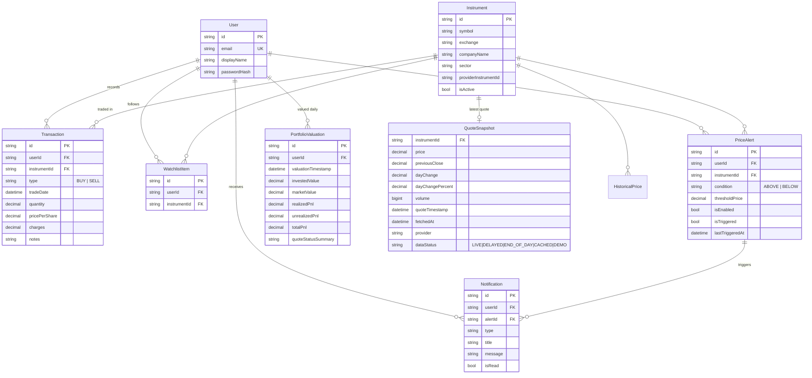

# Data model

Source of truth: `prisma/schema.prisma`. Money and quantities are `Decimal`
columns; nothing monetary is stored as a float.

Constraints that matter:

- `Instrument (exchange, symbol)` unique; `WatchlistItem (userId, instrumentId)` unique.
- `QuoteSnapshot.instrumentId` unique: one current quote per instrument, upserted; a failed refresh never overwrites it.
- `PortfolioValuation (userId, valuationTimestamp)` unique: one row per user per day.
- Every user-owned table cascades on user deletion, which is how "delete my account" removes everything.
- `HistoricalPrice` exists for a future cache; the MVP charts straight from the provider.
